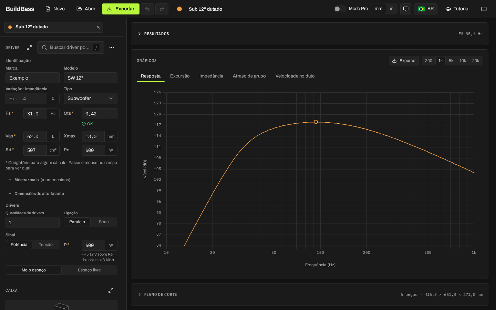
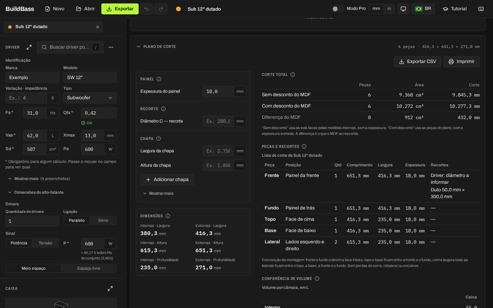
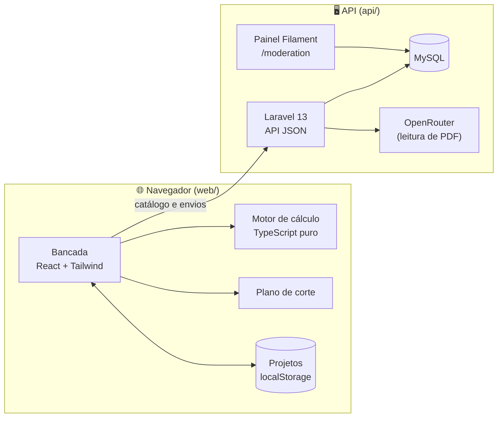

<div align="center">

<picture>
  <source media="(prefers-color-scheme: dark)" srcset=".github/assets/logo-dark.svg">
  
</picture>

<p><strong>Projete, simule e corte a sua caixa acústica direto no navegador.</strong><br>
Parâmetros Thiele-Small entram, curvas de resposta e um plano de corte pronto para a marcenaria saem.</p>

<p>
  <a href="https://github.com/guilhermemcr1/BuildBass/actions/workflows/tests.yml"></a>
  <a href="LICENSE"></a>
  
  
  
  
</p>

<p>
  <a href="https://buildbass.galarca.dev/"></a>
</p>

<p>
  <a href="#-recursos">Recursos</a> ·
  <a href="#-como-funciona">Como funciona</a> ·
  <a href="#-começando">Começando</a> ·
  <a href="#-testes-e-qualidade">Testes</a> ·
  <a href="#-o-motor-de-cálculo">Motor de cálculo</a> ·
  <a href="#-contribuindo">Contribuindo</a> ·
  <a href="#-créditos">Créditos</a>
</p>

<picture>
  <source media="(prefers-color-scheme: light)" srcset=".github/assets/screenshot-light.png">
  
</picture>

</div>

## ✨ Recursos

### 🔊 Simulação acústica

- **Quatro tipos de caixa:** selada, dutada, bandpass de 4ª ordem e bandpass de 6ª ordem.
- **Cinco gráficos:** resposta em frequência, excursão do cone, impedância, atraso de grupo e velocidade do ar no duto. Até 3 projetos podem ser sobrepostos no mesmo gráfico para comparação.
- **Resultados na hora:** F3, comprimento do duto, velocidade máxima no duto, potência no Xmax, sensibilidade, eficiência, volume líquido e 1ª ressonância de tubo.
- **Sugestão de caixa:** alinhamentos Butterworth (selada) e QB3, B4 ou C4 (dutada) calculados para as perdas reais da caixa.
- **Modelo realista:** perdas por vazamento (QL 5, 7, 10 ou 15), material de absorção, correção de ponta do duto (flangeada, livre, slot na parede ou personalizada) e bobina com perdas pelo modelo de Leach.
- **Vários drivers** em série ou em paralelo, sinal em watts ou volts, e radiação em meio espaço ou espaço livre.
- **Dutos** redondos, retangulares ou triangulares, um ou mais por caixa.
- **Verificação de consistência:** os parâmetros Thiele-Small são conferidos entre si, e cada campo mostra se o valor está OK, merece atenção ou tem erro.

### 🪚 Plano de corte

- **Peças com medidas** internas e externas, para qualquer tipo de caixa, já descontando o volume do driver, do duto e dos reforços.
- **Proporções** prontas (razão áurea, Louden e outras) ou personalizadas.
- **Encaixe nas chapas** a partir do seu estoque de chapas inteiras e sobras, com dois modos: **serra** (corte guilhotina) e **CNC/tupia** (corte livre, MaxRects).
- **Recortes** do alto-falante e do duto posicionados automaticamente ou à mão, digitando a medida ou arrastando no desenho.
- **Conferência de volume** por câmara, **vista 3D** da caixa montada, exportação em **CSV** e uma **folha de impressão** só com o plano.

<div align="center">
  
</div>

### 📚 Catálogo de drivers

- **Busca** por fabricante ou modelo. Ao escolher um driver, os parâmetros são copiados para o projeto, que continua editável.
- **Envio de drivers** para a comunidade, com moderação antes de entrar no catálogo e proteção anti-robô (Cloudflare Turnstile).
- **Preenchimento por manual:** anexe o PDF da ficha técnica e a IA sugere os campos, já convertidos para o SI. O PDF não fica guardado.
- **Meus alto-falantes:** guarde os seus drivers no navegador e exporte ou importe a lista.

### 🛡️ Painel de moderação

- Fila de envios com aprovação, rejeição com motivo e aviso por e-mail ao remetente.
- Cadastro de drivers com imagens (convertidas para WebP).
- Trilha de auditoria somente leitura e painel de uso com envios, aprovações e consumo da IA.

### 🧰 Bancada

- **Projetos em abas** (até 3), salvos automaticamente no navegador, com desfazer e refazer.
- Arquivos **`.buildbass.json`** para abrir e exportar projetos, compatíveis com todas as versões anteriores.
- **Exportação do gráfico** em PNG ou PDF, com legenda configurável (picos, F3/F10, dados da caixa e alertas).
- **Modo Normal e modo Pro**: só o essencial ou todos os campos.
- **Tutorial guiado** com destaque animado em cada painel.
- **pt-BR e inglês**, unidades métricas ou imperiais por campo, tema claro, escuro ou do sistema, e atalhos de teclado.
- **Funciona offline:** sem conexão, só o catálogo fica indisponível.

## 🧭 Como funciona



Todo o cálculo acontece **no navegador**. O motor acústico é um módulo TypeScript puro, sem dependências de interface, então simular, comparar e gerar o plano de corte não depende de servidor nem de conta. A API serve só o que precisa ser compartilhado: o catálogo de drivers, os envios da comunidade e o painel de moderação.

| Pasta | O que tem |
|---|---|
| [`web/`](web) | SPA em React 19 + TypeScript: bancada, motor (`src/engine`), plano de corte (`src/cutplan`), i18n e testes |
| [`api/`](api) | API em Laravel 13: catálogo, envios, leitura de manual por IA e painel de moderação em Filament |
| [`.github/`](.github) | CI (testes do front e da API), Dependabot e imagens deste README |

### Stack

| Front-end | Back-end |
|---|---|
| React 19 · TypeScript · Vite+ | PHP 8.3+ · Laravel 13 |
| Tailwind CSS 4 · React Aria Components | Filament 5 (painel de moderação) |
| Zustand + Zundo (estado e desfazer) | MySQL (SQLite em memória nos testes) |
| uPlot (gráficos) · Zod (validação) | Pest · Larastan · Pint |
| i18next · Vitest · Playwright + axe | poppler-utils + OpenRouter (leitura de PDF) |

## 🚀 Começando

### Pré-requisitos

- **Node.js 22+** para o front
- **PHP 8.3+** com Composer e a extensão GD (com WebP) para a API
- **MySQL 8** (ou compatível) para a API
- Opcional: `poppler-utils` para a leitura de manuais em PDF

### Só o simulador (sem back-end)

O simulador funciona sozinho. Sem a API, só a busca no catálogo e o envio de drivers ficam desativados.

```bash
cd web
npm ci
cp .env.example .env
npm run dev          # http://localhost:5173
```

### Com a API

```bash
cd api
composer setup                                  # instala, cria o .env e gera a chave
# ajuste DB_* no .env para um banco MySQL vazio
php artisan migrate
php artisan db:seed --class=DriverSeeder        # catálogo inicial
php artisan storage:link                        # imagens dos drivers
php artisan moderator:create voce@exemplo.com --name="Seu Nome"
./serve-local.sh                                # http://localhost:8000 com limites de upload maiores
```

O painel de moderação fica em `http://localhost:8000/moderation`. Os detalhes da API, as variáveis de ambiente e os requisitos de produção estão no [README da API](api/README.md).

### Variáveis de ambiente

| Onde | Variável | Para quê |
|---|---|---|
| `web/.env` | `VITE_API_URL` | Endereço da API (padrão `http://localhost:8000`) |
| `web/.env` | `VITE_TURNSTILE_SITE_KEY` | Chave pública do Turnstile (vazia = sem captcha) |
| `api/.env` | `FRONTEND_URL` | Origens do front liberadas no CORS |
| `api/.env` | `TURNSTILE_ENABLED`, `TURNSTILE_SECRET` | Anti-robô nos envios |
| `api/.env` | `MANUAL_EXTRACTION_ENABLED`, `OPENROUTER_API_KEY`, `OPENROUTER_MODEL` | Leitura de manual por IA |

## 🧪 Testes e qualidade

```bash
# Front-end
cd web
npm run check         # formatação e lint
npm run types:check   # TypeScript
npm run test          # testes unitários e de componentes (Vitest)
npm run test:e2e      # ponta a ponta com Playwright, incluindo acessibilidade (axe)

# API
cd api
composer test         # Pint, Larastan e Pest (SQLite em memória)
```

O CI roda tudo isso a cada push na `main` e em cada pull request.

## 📐 O motor de cálculo

O motor em [`web/src/engine`](web/src/engine) resolve o circuito equivalente eletro-mecano-acústico do alto-falante e da caixa em cada frequência. Cada equação cita no código a fonte pública de onde veio:

- **A. N. Thiele**: *Loudspeakers in Vented Boxes* (1961/1971) e a família de alinhamentos QB3, B4 e C4
- **R. H. Small**: os artigos do JAES (1972–1973) sobre caixas seladas e dutadas e as relações Thiele-Small
- **D. B. Keele Jr.**: aproximações dos alinhamentos (1973)
- **W. M. Leach Jr.**: modelo de bobina com perdas (2002)
- **V. Dickason**: *Loudspeaker Design Cookbook*
- **L. L. Beranek**: *Acoustics*

Os valores padrão seguem as convenções mais usadas no mercado (correção de ponta 0,732·D, QL 7, c ≈ 343 m/s). Uma suíte de regressão compara o motor com casos publicados por fabricantes e com tabelas de alinhamento, e as fórmulas fechadas são conferidas por implementações independentes nos testes.

## 🤝 Contribuindo

Contribuições são bem-vindas, sejam elas correções, novos tipos de caixa, traduções ou drivers para o catálogo.

1. Faça um fork e crie uma branch a partir da `main` (`feature/minha-ideia` ou `fix/o-que-corrige`).
2. Rode os testes e as verificações dos dois projetos antes de abrir o PR.
3. Use [Conventional Commits](https://www.conventionalcommits.org/pt-br/) (`feat(engine): …`, `fix(web): …`).
4. Equações novas no motor precisam citar a fonte e vir acompanhadas de testes contra um caso conhecido.

Encontrou um resultado estranho? Abra uma [issue](https://github.com/guilhermemcr1/BuildBass/issues) com o arquivo `.buildbass.json` do projeto e o valor que você esperava.

## 🙌 Créditos

Idealizado e desenvolvido por **Guilherme G.**

[](https://github.com/guilhermemcr1)
[](https://galarca.dev)

O BuildBass se apoia na teoria publicada por Thiele, Small, Keele, Leach, Dickason e Beranek e em software livre de terceiros. A lista completa de referências, dados, bibliotecas, fontes e agradecimentos está em [CREDITS.md](CREDITS.md). No app, o botão ⓘ da barra do topo abre a tela **Sobre**.

Usou o BuildBass em um trabalho? O GitHub gera a citação pelo botão **Cite this repository**, a partir do [CITATION.cff](CITATION.cff).

## 📄 Licença

Distribuído sob a licença [MIT](LICENSE).

<div align="center">
<sub>Feito com 🎶 e muito MDF.</sub>
</div>
